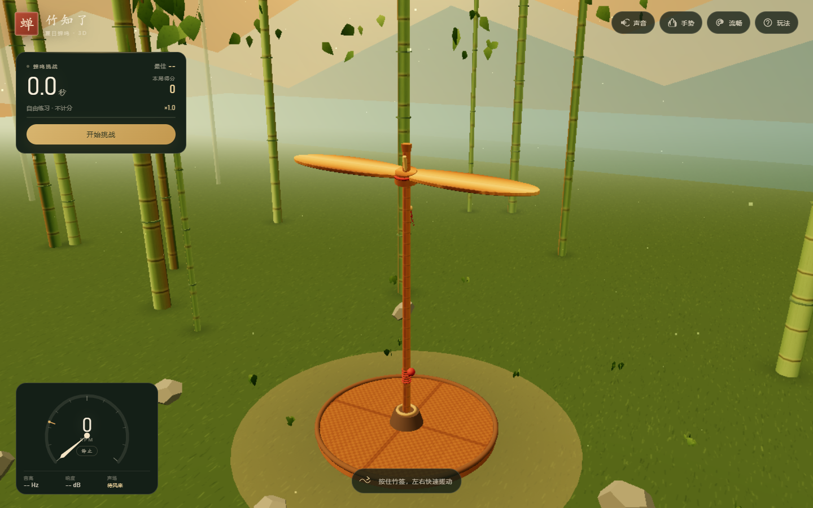
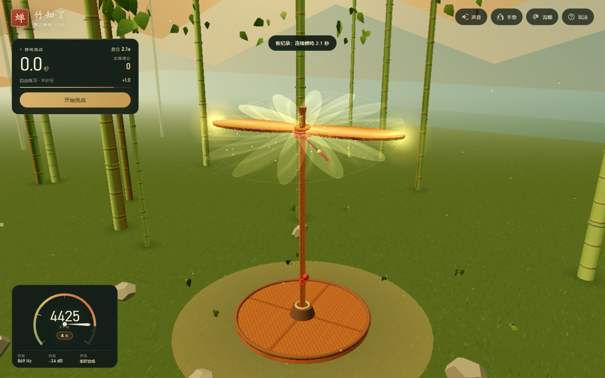
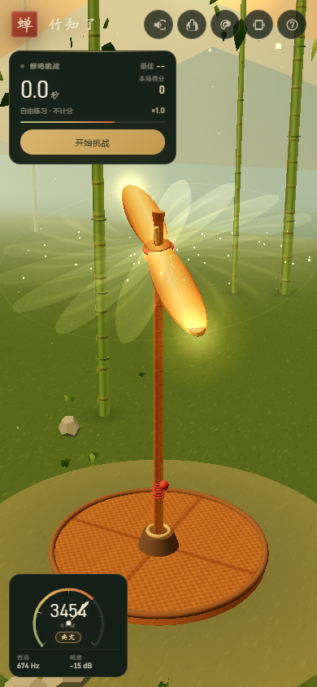

# 竹知了 · 3D 夏日蝉鸣

一个用 Three.js + Web Audio API + MediaPipe Hands 制作的 3D「竹知了」仿真网页游戏。

一根竹签，一片薄竹翼。搓得越快，竹翼转得越急，蝉鸣就越高、越响；松手之后，空气阻力和轴摩擦让转速自然衰减，声音也跟着变闷、变低，最后归于安静。

## 启动

需要 Node.js 18+。Three.js 和 MediaPipe Hands 已经放进 `vendor/`，**运行游戏本身不需要安装任何 npm 依赖**。

```bash
npm start
# 或
node server.mjs
```

打开 <http://127.0.0.1:4173/>。

Windows 也可以直接双击 `启动游戏.bat`。

> 游戏使用 ES Module 和 AudioWorklet，不能直接双击 `index.html` 以 `file://` 打开，请通过本地服务器访问。
> 摄像头手势还要求安全上下文：`localhost`、`127.0.0.1` 或 HTTPS。手机通过局域网访问时，建议使用 HTTPS；否则浏览器会拒绝摄像头。

## 操作

| 方式 | 操作 |
| --- | --- |
| 鼠标 | 按住竹签或竹翼左右快速拖动；拖拽空白处旋转视角，滚轮缩放 |
| 触屏 | 单指按住竹签左右搓动；双指缩放；拖拽空白处转视角 |
| 键盘 | 交替按 `←` / `→` 搓动，`空格` 轻甩，`M` 静音 |
| 摇一摇 | 点击顶部手机图标授权后，晃动手机给竹翼加速 |
| 摄像头 | 点击顶部手掌图标，允许摄像头后，把手掌放进画面左右搓动 |
| 声音 | 点击右上角声音按钮静音 / 恢复 |

### 挑战规则

点击「开始挑战」后，把转速保持在 **1200 RPM** 以上，蝉鸣计时和分数就会增长。

- 转速越高，得分倍率越高。
- 蝉鸣中断超过 **2.2 秒**，本局结束；开始后 9 秒内没达到 1200 RPM 也会结束。
- 最好连续蝉鸣时长、最高得分和最高转速保存在浏览器 `localStorage` 中。

### 画质模式

右上角「流畅 / 高画质」按钮：

- **流畅（默认）**：30fps、内部 720p 上限、8 层轻量竹翼残影、无实时阴影、无全屏后处理。优先保证核显和 CPU 占用。
- **高画质**：旋转时 60fps、内部 1080p 上限、EffectComposer + AfterimagePass。GPU 负载会明显增加；如果持续低于 48fps 会自动退回流畅模式。
- 命令行快捷键：`Q` 切换画质，`M` 静音。

## 实现要点

### 3D / 视觉

- Three.js 实时渲染，程序化生成竹材纹理、竹节、竹叶、山地、草地、竹席和薄竹翼。
- 竹翼由带倒角的挤出几何体构成；竹签、竹翼、红绳流苏、轴承和竹席均为 3D 模型。
- 默认残影：8 层轻量 GPU 竹翼副本 + 加法扫掠光盘 + 翼尖辉光，不经过全屏后处理；旧的 36 组残影网格已移除。
- 高画质残影：`EffectComposer + AfterimagePass` 全 GPU 时间累积，阻尼与实时转速连续关联。
- 竹竿、竹节、远景竹竿分别合并为 InstancedMesh；总 draw call 从约 140 降到默认 **54–90**（随残影层数变化），三角形约 27k。
- 固定微倾的转子平面让薄竹翼在默认视角也能看清厚度，同时保留随转速变化的 wobble。
- OrbitControls 支持旋转、缩放观察；桌面和手机布局分别适配，处理安全区和触摸事件。

### 性能预算（本次重构）

| 项目 | 重构前 | 默认流畅 | 高画质 |
| --- | --- | --- | --- |
| 帧循环 | 跟随屏幕刷新率，可达 120fps | **30fps** | 旋转 60fps / 空闲 30fps |
| 残影 | 36 组网格，约 72 个额外 draw call | 8 层轻量副本 | AfterimagePass |
| Draw calls | 约 140 | **54–90** | 61 |
| 渲染分辨率 | DPR 最高 2.0 | 内部 ≤ 1280×720 | 内部 ≤ 1920×1080 |
| 实时阴影 | 2048²，每帧更新 | 关闭 | 关闭 |
| 后台 | rAF 继续运行 | `visibilitychange` 立即停循环、停音频、停摄像头 | 同左 |
| 摄像头 | 24fps，打开面板即启动 | **15fps**，独立开关 | 同左 |
| 物理 | 最多 13 个 0.02s 子步 | 固定 1/60s 累积器，**maxSubSteps = 4** | 同左 |

额外优化：

- `preserveDrawingBuffer: false`、关闭 MSAA、移除 `backdrop-filter`、移除全屏 `mix-blend-mode` 噪点层和 SVG 高斯模糊。
- 移除实时阴影和阴影采样，仅保留接触阴影与竹竿落地阴影。
- 光照从 4 盏减为半球光 + 平行光 2 盏；竹材从 PhysicalMaterial 降为 StandardMaterial。
- 草地粒子、飘尘和竹叶摆动降为 30Hz 更新。
- 移除大面积雾片叠层，云层从 6 个减为 3 个。
- **HUD 才是隐藏的 GPU 大头**：移除仪表盘 SVG / 挑战进度 / 提示箭头的连续 CSS 过渡和动画，HUD 改为不透明背景、无大阴影；仪表盘 10Hz、挑战卡 5Hz 更新；删除 2D 波形画布和全屏 CSS 暗角。
- Edge 硬件加速实测 GPU 进程：默认旋转约 **0.21 个 CPU 核心**、空闲约 0.13 核；高画质旋转约 0.29 核（CDP 单核基准）。此前同一测量方式下默认旋转约 0.46 核。
- 静止时 AudioWorklet 直接输出静音块，不再逐样本计算振荡器。
- 高画质下帧率持续低于 48fps 时自动退回流畅模式；模态框打开时也会暂停渲染。
- 窗口 resize 使用 120ms 防抖，并同步更新 Renderer 与 Composer 的渲染目标。
- 页面卸载时释放 Composer / Renderer；Afterimage 使用固定数量的 render target，不会每帧创建纹理。
- 静态资源带版本参数，避免 Edge/Chrome 使用旧版脚本缓存。

### 旋转物理

转子只有一个自由度，角速度 `ω` 的变化为：

```text
dω/dt = -c₁·ω - c₂·ω² - breakaway + userTorque
```

- `c₁ = 0.128`：轴承 / 轴摩擦（与转速成正比）
- `c₂ = 0.000074`：空气阻力（与转速平方成正比）
- 搓动输入按屏幕归一化距离和拖动速度换算成角冲量，接近最高转速时有递减收益。
- 最高转速 5200 RPM；物理使用基于真实时间的 1/60s 固定步长累积器，并且 `maxSubSteps = 4`，既不会在低帧率下变慢，也不会出现死亡螺旋。
- 风阻、摩擦、流苏离心外摆和转子 wobble 都由实时角速度驱动。

### 声音：全部实时合成

**没有加载任何录音文件，也没有使用任何预录音频。**

蝉鸣由内联的 `AudioWorkletProcessor` 以 48 kHz 逐样本合成，主线程只把实时 RPM 写入 AudioParam：

- 基频随转速连续上升：`f₀ ≈ 100 + 930·(rpm/5200)^1.18 Hz`
- 9 个非严格谐波 + 一层轻微失谐的合唱泛音，构成薄竹片的高频嗡鸣。
- 旋转周期对振幅进行调制（叶片掠过频率），叠加 2.15–6 Hz 的慢速“哇呜”包络，形成竹知了标志性的周期鸣叫。
- 白噪声经过状态变量带通滤波，截止频率随转速从约 680 Hz 扫到约 5.9 kHz，模拟切割空气的气流声。
- 声音经软饱和、动态压缩和程序生成的短混响送出；转速归零时包络自然释放。
- 所有调制都使用连续量，没有分档。转速下降时音高、亮度、响度和调制速度一起下降，直至静音。
- 合成器同时挂接 `AnalyserNode`，驱动界面左下角的实时波形。

自动验收中，离线渲染实测：

| RPM | RMS | 主导频率 | 频谱质心 |
| ---: | ---: | ---: | ---: |
| 0 | 0 | — | — |
| 300 | -45.8 dB | 132 Hz | 1454 Hz |
| 800 | -27.4 dB | 202 Hz | 1349 Hz |
| 1800 | -19.8 dB | 366 Hz | 2561 Hz |
| 3000 | -16.1 dB | 586 Hz | 3595 Hz |
| 4500 | -13.9 dB | 885 Hz | 4144 Hz |
| 5200 | -13.0 dB | 1031 Hz | 4633 Hz |

300 RPM 时已能听到很轻的低鸣；5200 RPM 时响度、基频和高频亮度都明显提升。

### 手势识别

- 使用本地化的 MediaPipe Hands（`@mediapipe/hands`），不依赖外部 CDN。
- 摄像头流限制 15fps，MediaPipe 推理循环同样限制 15fps；面板打开不会自动启动，必须点击独立的摄像头开关。
- 切到后台、打开帮助/结算弹窗或关闭面板时立即停止摄像头与 MediaPipe。
- 根据手腕与四个掌指关节计算掌心位置，对连续帧做平滑和速度估计。
- 检测左右方向的往返运动；每次有效反向和持续搓动都会给转子增加角冲量，并同步驱动界面手势能量条。
- 摄像头画面只在浏览器本地处理，不上传、不录制。

### 挑战与记录

- 1200 RPM 为蝉鸣阈值，2.2 秒中断宽限。
- 实时计时、倍率、得分，默认流畅模式以 10Hz/5Hz 刷新区块，避免 HUD 持续重绘吃掉 GPU。
- `localStorage` 保存 `bestTime`、`bestScore`、`bestRpm`、`runs`。
- 挑战结束后显示本局统计和新纪录提示。

## 文件结构

```text
index.html                 页面与 UI
css/style.css              视觉样式、响应式布局
js/main.js                 游戏流程、输入、挑战、UI
js/scene.js                Three.js 场景、竹知了模型、残影、粒子
js/physics.js              转子物理
js/audio.js                AudioWorklet 蝉鸣合成器 + 离线分析
js/gestures.js             MediaPipe Hands 手势控制
vendor/three/              本地 Three.js
vendor/mediapipe/hands/    本地 MediaPipe Hands 模型与 wasm
server.mjs                 静态服务器
tests/verify.mjs           浏览器自动验收
tests/physics-check.mjs    物理衰减 / 搓动输入检查
docs/                      截图、验收报告与性能报告
```

## 自动验收

自动验收需要先安装测试依赖，并保持本地服务器运行：

```bash
npm install
npm start
# 另一个终端
npm test
```

测试使用本机 Chrome 或 Edge（`puppeteer-core`），覆盖：

- 音频在 0 / 300 / 800 / 1800 / 3000 / 4500 / 5200 RPM 的响度、主导频率、频谱质心与“哇呜”调制；
- 静音、自然衰减、实时 analyser 电平；
- 空气阻力衰减；
- **默认流畅模式 30fps / 720p 像素预算、高画质 60fps / 1080p / AfterimagePass、draw call 数量**；
- **页面切后台暂停、帮助弹窗暂停、返回前台恢复**；
- 挑战计时、计分、结束与 `localStorage` 持久化；
- 鼠标、触摸、键盘、摇一摇四种输入；
- **摄像头独立开关、15fps 限制**，以及用模拟掌心轨迹验证手势到转速的映射；
- 手机布局、实时得分可见性和横向溢出。

最新报告见 [docs/verification-report.txt](docs/verification-report.txt) 与 [docs/performance-report.txt](docs/performance-report.txt)。

## 截图







## 调研参考

传统「竹蝉 / 竹知了」在不同地区有甩绳竹筒式、搓杆薄竹翼式等做法。本项目按照需求采用薄竹翼搓杆式造型；声音合成参考了竹片振动、转速周期调制和竹腔共鸣的听感特征。

- [百度百科：竹知了](https://baike.baidu.com/item/%E7%AB%B9%E7%9F%A5%E4%BA%86/68400411)
- [竹蟬的聲學（中山大學物理演示）](https://www2.nsysu.edu.tw/physdemo/2012/A4/A4pic/2010%E7%9C%8B%E6%9D%BF.pdf)
- [嘉義縣第 54 屆中小學科學展覽：童玩「竹蟬」](https://science.cyc.edu.tw/upfile/science103/work_files/12835279890615.pdf)
- [丝路视听：几块钱的竹知了卖断货，这个千年老玩具凭什么火遍全网？](https://slstnews.xjtvs.com.cn/Share/ArticleShare?ArticleId=4305785)
- [维基百科：叫蝉](https://zh.wikipedia.org/wiki/%E5%8F%AB%E8%9D%89)

## 许可

本项目以 **MIT License** 开源，见 [LICENSE](LICENSE)。Three.js（MIT）与 MediaPipe Hands（Apache-2.0）遵循各自仓库中的许可证；`vendor/` 内保留了原始版权声明。
